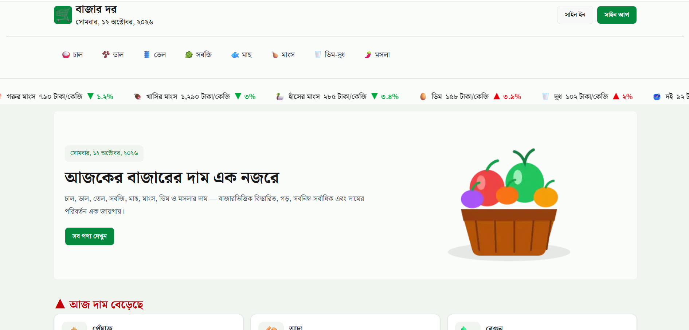

# 🛒 বাজার দর | BazarDor

**প্রয়োজনীয় পণ্যের দাম এক নজরে**

BazarDor is a responsive web application that helps users explore and compare the daily prices of essential products in Bangladesh. It provides market-wise pricing information, price change indicators, category-based browsing, and product details to help users stay informed about daily market trends.

## 📸 Screenshot



## 🛠️ Technologies Used

- **Next.js** — React framework with App Router
- **React** — User interface development
- **TypeScript** — Type-safe development
- **Tailwind CSS** — Responsive styling
- **DaisyUI** — UI components
- **Better Auth** — Authentication and session management
- **MongoDB** — Database
- **React Hot Toast** — Notifications and toast messages
- **Vercel** — Deployment and hosting

## ✨ Key Features

- **📊 Daily Price Tracking:** Explore the latest available prices of essential products.
- **📈 Price Change Indicators:** Identify products with increasing or decreasing prices.
- **🔎 Product & Category Browsing:** Browse products and filter them by category.
- **🏷️ Detailed Price Information:** View minimum, maximum, and average prices, along with market-wise pricing.
- **🔐 Secure Authentication:** Sign in or register using email and password, Google, or GitHub.
- **👤 Profile Management:** View and update user profile information.
- **📱 Responsive Design:** Enjoy a consistent experience across mobile, tablet, and desktop devices.
- **🔢 Price Sorting:** Sort products by default order, lowest price, or highest price.
- **⚡ Loading Skeletons:** Display loading placeholders while data is being fetched.
- **🔔 Toast Notifications:** Receive feedback for important user actions.

## 📦 Dependencies & Installation

### Prerequisites

Make sure you have the following installed:

- Node.js
- npm
- MongoDB database
- Git

### 1. Clone the Repository

```bash
git clone https://github.com/Wasima230Sultana/Bazar-Dor.git
cd Bazar-Dor
```

### 2. Install Dependencies

```bash
npm install
```

### 3. Configure Environment Variables

Create a `.env.local` file in the root directory and configure the environment variables required by your application.

Example:

```env
MONGODB_URL=your_mongodb_connection_string

BETTER_AUTH_SECRET=your_better_auth_secret
BETTER_AUTH_URL=http://localhost:3000

GOOGLE_CLIENT_ID=your_google_client_id
GOOGLE_CLIENT_SECRET=your_google_client_secret

GITHUB_CLIENT_ID=your_github_client_id
GITHUB_CLIENT_SECRET=your_github_client_secret
```


### 4. Run the Development Server

```bash
npm run dev
```

Open [http://localhost:3000](http://localhost:3000) in your browser.

### 5. Build for Production

```bash
npm run build
```

To start the production server locally after building:

```bash
npm start
```

## 🌐 Live Demo & Links

- **Live Website:** [BazarDor](https://bazar-dor-cyan.vercel.app/)
- **GitHub Repository:** [Wasima230Sultana/bazar-dor](https://github.com/Wasima230Sultana/Bazar-Dor)

## 🎯 Project Goal

BazarDor aims to make essential product prices easier to access and compare, helping people in Bangladesh stay informed about daily market prices and price fluctuations.

## 📄 License

This project was developed for educational purposes.